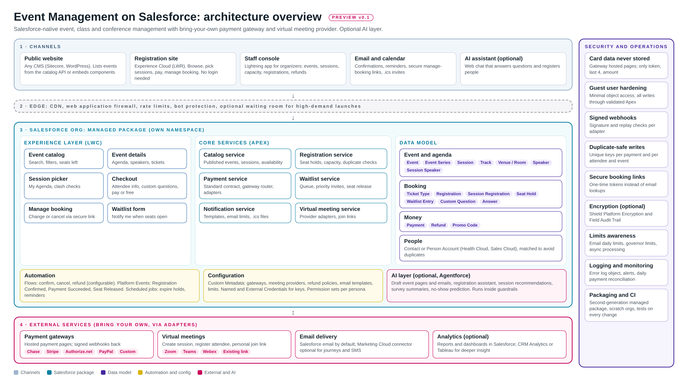

# Event Management on Salesforce: High-Level Design (HLD)

**Status:** Preview v0.1 (brainstorm). Not tied to any customer. Everything here is open for review.

## 1. Purpose and scope

A Salesforce-native solution to plan, sell and run classes, events and multi-day conferences:

- **In scope:** event catalog, conference agenda (sessions, tracks, rooms, speakers), registration
  (free and paid), seat limits and holds, duplicate prevention, waitlist, cancellations and refunds,
  confirmation and reminder emails, calendar invites, virtual meeting links, staff console, reports.
- **Pluggable:** payment gateways and virtual meeting providers ("bring your own").
- **Optional:** AI features (Agentforce), Marketing Cloud journeys, attendance check-in, analytics.
- **Out of scope for v1:** native mobile app, hotel and travel booking, exhibitor floor plans.

## 2. Design principles

1. **Salesforce native first.** Data, logic and admin stay in Salesforce; admins can own it.
2. **Configure, don't code.** Gateways, providers, policies and templates live in Custom Metadata.
3. **Bring your own.** One standard contract each for payments and virtual meetings; adapters per vendor.
4. **Never store card data.** Gateway hosted pages only; Salesforce keeps a token, last 4 and amount.
5. **Duplicate-safe and overbooking-safe.** Unique keys and locked seat counts on every booking.
6. **Simple for the attendee.** No login needed; secure one-time links to change or cancel.
7. **Reuse before build.** Fit into an org's existing objects, flows, email and payment setup.

## 3. Personas

| Persona | Needs |
|---|---|
| Attendee (patient, caregiver, consumer, provider) | Find an event, pick sessions, pay or register free, get confirmation, change or cancel |
| Organizer (staff) | Create events and agendas, set capacity and prices, see registrations, handle refunds |
| Finance | Reconcile payments and refunds per gateway and cost center |
| Admin | Configure gateways, providers, templates, permissions; deploy updates |

## 4. Architecture layers

| Layer | Components | Notes |
|---|---|---|
| 1. Channels | Public website (any CMS), Experience Cloud registration site (LWR), staff Lightning console, email and calendar, optional AI chat | CMS lists events from a catalog API or embeds components |
| 2. Edge | CDN, web application firewall, rate limits, bot protection, optional waiting room | Experience Cloud CDN covers most needs; waiting room only for high-demand launches |
| 3. Salesforce package | Experience layer (LWC), core services (Apex), data model, automation, configuration, AI layer | Second-generation managed package with its own namespace |
| 4. External services | Payment gateways, virtual meeting providers, email delivery, analytics | Connected through adapters, Named Credentials and signed webhooks |

## 5. Core components

| Component | Responsibility |
|---|---|
| Catalog service | Returns published events, sessions and live availability for the website and site |
| Registration service | Creates registrations, holds seats for a set time, enforces capacity, blocks duplicates |
| Payment service | Standard payment contract, gateway router (per event or business unit), adapters, webhooks, refunds |
| Waitlist service | Captures interest when full, offers released seats, sends priority invites for new dates |
| Notification service | Sends confirmations, reminders, change and cancel links, .ics invites; respects email limits |
| Virtual meeting service | Creates online sessions with the chosen provider, registers attendees, stores join links |
| Staff console | Lightning app: event setup, agenda builder, registrations, refunds, dashboards |
| AI layer (optional) | Content drafting, registration assistant, recommendations, survey summaries, no-show prediction |

## 6. Key flows (summary)

1. **Browse:** website or site calls the catalog service; shows events with seats left.
2. **Register (free):** attendee picks sessions and enters details; registration service checks
   duplicates and capacity, confirms instantly; confirmation email with .ics and join link.
3. **Register (paid):** seat held (for example 10 minutes); payment service creates a session with the
   chosen gateway; attendee pays on the hosted page; signed webhook confirms; registration confirmed.
4. **Change or cancel:** attendee opens the secure link from the email; changes sessions or cancels;
   refund rules from configuration; refund sent through the same gateway adapter.
5. **Full event:** attendee joins the waitlist; when a seat is released or a new date opens, waitlisted
   people are invited first for a priority window.
6. **Staff setup:** organizer creates the event, ticket types, sessions, rooms, speakers and capacity;
   publishes; agenda appears on the site.
7. **Online session:** virtual meeting service creates the meeting or webinar and a personal join link
   per attendee; link goes into confirmation and reminder emails.

Detailed sequences are in the LLD.

## 7. Integration overview

| Integration | Pattern | Security |
|---|---|---|
| Payment gateways | Adapter per gateway; hosted payment page; webhook to a public Apex REST endpoint | Named Credentials, signed webhooks, replay check, idempotency key |
| Virtual meetings | Adapter per provider (Zoom, Teams, Webex, or a static link) | OAuth through External Credentials |
| Public website (CMS) | Read-only catalog endpoint or embedded LWC | Cached, read only, no personal data |
| Email | Salesforce email (Flow email alerts) by default; Marketing Cloud connector optional | Org-wide email address, unsubscribe handling |
| Calendar | Generated .ics attachment and add-to-calendar links | None needed |

## 8. Non-functional requirements

| Area | Target (preview, to be validated) |
|---|---|
| Availability | Salesforce platform SLA; webhook retries handled by gateways and idempotent processing |
| Performance | Catalog pages cached; checkout in under 3 seconds excluding the gateway page |
| Scalability | Seat holds with row locking; async processing for emails and integrations; waiting room for spikes |
| Security | Guest user least privilege; validated Apex for all writes; no card data; optional Shield encryption |
| Compliance | PCI kept to the simplest level via hosted pages; HIPAA BAA scope for healthcare orgs [to confirm] |
| Limits | Email via Flow alerts to stay within daily limits; bulk-safe Apex; governor limits tested |
| Accessibility | WCAG 2.1 AA for the registration site |

## 9. Deployment and packaging

- Second-generation managed package, own namespace, versioned releases.
- Source in this repo (Salesforce DX). Scratch orgs for development; CI runs tests and static analysis
  on every change; AppExchange security review before any listing.
- Customer-specific setup (gateway, provider, templates) is configuration, not code.

## 10. Assumptions and open questions

- Which Salesforce clouds are assumed (Sales, Service, Health Cloud)? Person Accounts or Contacts?
- Experience Cloud licensing for a public, no-login site (guest user) is assumed.
- First gateways and providers to support for launch.
- Is attendance check-in a core feature or an add-on?
- Pricing and packaging model for AppExchange (later).

## 11. Roadmap (indicative)

1. **Core:** catalog, agenda, registration, seat holds, free and paid, one gateway, emails.
2. **Bring your own:** gateway router plus 2 to 3 adapters; virtual meeting adapters.
3. **Waitlist and self-service:** priority invites, secure change and cancel links.
4. **AI layer:** content drafting, assistant, survey summaries.
5. **Add-ons:** check-in, badges, CME or CE credits, sponsors, Marketing Cloud journeys.
