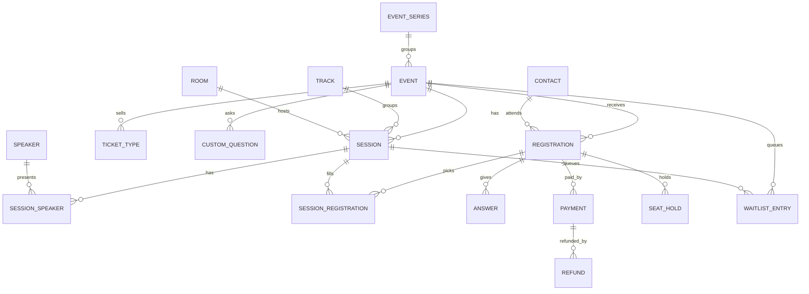
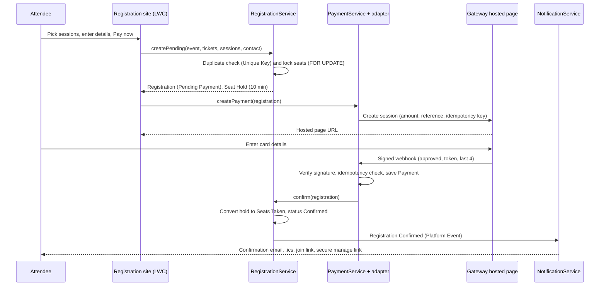
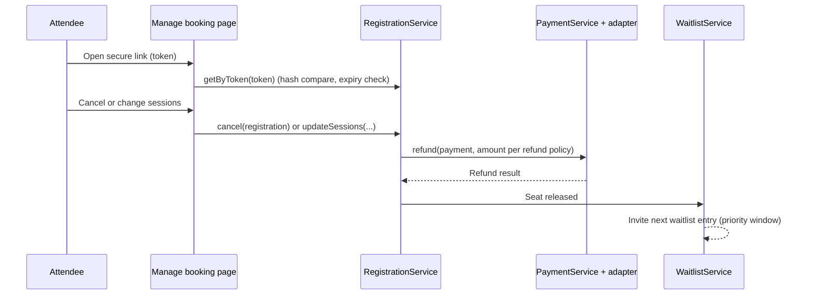

# Event Management on Salesforce: Low-Level Design (LLD)

**Status:** Preview v0.1 (brainstorm). Names, fields and limits are proposals for review.
Namespace placeholder: `evm` (custom objects shown without the prefix for readability).

## 1. Data model



### 1.1 Objects and key fields

| Object | Key fields | Notes |
|---|---|---|
| Event Series | Name, Description, Default ticket types | Optional grouping for recurring classes |
| Event | Name, Type (Class, Event, Conference), Format (In person, Online, Hybrid), Start, End, Time zone, Venue, Status (Draft, Published, Open, Closed, Cancelled), Capacity, Seats Taken, Seats Held, Registration Opens, Registration Closes, Gateway Config (lookup to CMDT key), Meeting Provider (CMDT key), Business Unit, Public Slug | Seats Available is a formula: Capacity minus Taken minus Held |
| Session | Event, Title, Abstract, Track, Room, Start, End, Capacity, Seats Taken, Seats Held, Online Join Mode, Meeting Id, Status | Capacity optional; falls back to room capacity |
| Track | Event, Name, Color | |
| Room (Venue) | Name, Location, Capacity | |
| Speaker / Session Speaker | Contact, Bio, Photo; junction to Session with Role | |
| Ticket Type | Event, Name, Audience (Provider, Nurse, Caregiver, Public), Price, Currency, Quantity Limit, Active | Price 0 means free |
| Custom Question / Answer | Event, Label, Type, Required, Options; Answer to Registration | Per-event questions without code |
| Registration | Event, Contact, Ticket Type, Status (Pending Payment, Confirmed, Cancelled, Refunded, Expired), Source, Amount, Currency, Unique Key, Manage Token Hash, Token Expires, Confirmed At | Unique Key = Event Id + normalized email (external ID, unique) |
| Session Registration | Registration, Session, Status | Unique on Registration + Session |
| Seat Hold | Registration, Event, Session, Quantity, Expires At, Status (Active, Released, Converted) | Released by scheduled job |
| Waitlist Entry | Event or Session, Contact, Preferences, Priority, Status (Waiting, Invited, Converted, Expired), Invited At, Invite Expires | |
| Payment | Registration, Gateway, Gateway Reference, Idempotency Key, Token, Last4, Amount, Currency, Status (Initiated, Succeeded, Failed), Raw Event Id | Idempotency Key unique; never stores card number or CVV |
| Refund | Payment, Amount, Reason, Gateway Reference, Status | Partial refunds allowed |
| Promo Code | Event, Code, Discount, Max Uses, Used | Optional |
| Integration Log | Direction, System, Endpoint, Status, Correlation Id, Payload (redacted), Error | For support and audits |

People: Registrations look up to Contact (or Person Account). Matching rule on email plus name
prevents duplicate contacts; a new Contact is created only when no match exists.

## 2. Apex design

### 2.1 Layers

| Layer | Classes (proposed) |
|---|---|
| Controllers (LWC, Aura-enabled) | `CatalogController`, `CheckoutController`, `ManageBookingController`, `WaitlistController`, `StaffConsoleController` |
| REST endpoints | `PaymentWebhookResource` (`/evm/v1/webhooks/payments/*`), `CatalogResource` (`/evm/v1/catalog`) |
| Services | `CatalogService`, `RegistrationService`, `SeatHoldService`, `PaymentService`, `WaitlistService`, `NotificationService`, `VirtualMeetingService`, `CalendarService` |
| Plug-in contracts | `IPaymentGateway`, `IVirtualMeetingProvider` |
| Adapters | `ChasePaymentGateway`, `StripePaymentGateway`, `AuthorizeNetPaymentGateway`, `PayPalPaymentGateway`, `ZoomMeetingProvider`, `TeamsMeetingProvider`, `StaticLinkMeetingProvider` |
| Selectors and domain | `EventSelector`, `SessionSelector`, `RegistrationSelector`; trigger handlers per object |
| Async | `SeatHoldReleaseJob` (Schedulable), `ReminderJob`, `NotificationQueueable`, `MeetingRegistrationQueueable` |

### 2.2 Payment contract

```apex
public interface IPaymentGateway {
    PaymentSession createPayment(PaymentRequest request);      // returns hosted page URL and gateway reference
    WebhookResult handleWebhook(RestRequest request);           // verifies signature, parses outcome
    RefundResult refund(Payment__c payment, Decimal amount, String reason);
    void cancel(Payment__c payment);                            // void an unsettled payment if supported
    PaymentStatus getStatus(String gatewayReference);           // used by reconciliation and retries
}
```

- `PaymentGatewayRouter.forEvent(Event__c e)` reads `Payment_Gateway_Config__mdt` (adapter class name,
  Named Credential, merchant id, currencies, webhook secret reference) and returns an instance via
  `Type.forName(...)`. Customers can register a custom adapter class without changing the package.
- Every request carries an **Idempotency Key** (Registration Id + attempt). Webhooks are matched on
  Gateway Reference; a repeated webhook finds the existing Payment and does nothing.

### 2.3 Virtual meeting contract

```apex
public interface IVirtualMeetingProvider {
    MeetingInfo createMeeting(Session__c session);              // meeting or webinar id, host link
    JoinLink registerAttendee(Session__c session, Contact c);   // personal join link
    void cancelAttendee(Session__c session, Contact c);
    List<AttendanceRecord> getAttendance(Session__c session);   // optional, if attendance is in scope
}
```

`StaticLinkMeetingProvider` covers orgs that already have a meeting link process.

## 3. Key sequences

### 3.1 Paid registration



### 3.2 Change or cancel with refund



## 4. Seat holds and overbooking

1. `SeatHoldService.hold()` runs `SELECT ... FROM Session__c WHERE Id IN :ids FOR UPDATE` (and the
   Event row) so concurrent buyers queue on the row lock.
2. If `Capacity - Seats Taken - Seats Held >= requested`, increment Seats Held and insert Seat Hold
   with `Expires At = now + hold minutes` (Custom Metadata, default 10).
3. On payment success, convert: Seats Held minus n, Seats Taken plus n, hold status Converted.
4. `SeatHoldReleaseJob` (every 5 minutes) releases expired holds and notifies the waitlist service.
5. Free registrations skip the hold and convert in the same transaction.
6. Very high demand: put a waiting room in front of the site so only an admitted rate reaches Salesforce.

## 5. Duplicate prevention

| Case | Rule |
|---|---|
| Same person, same event | Registration Unique Key (Event Id + normalized email), external ID set to unique |
| Same session twice | Session Registration unique on Registration + Session |
| Payment retry or double click | Idempotency Key unique on Payment; webhook matched on Gateway Reference |
| Repeated webhook | Stored Raw Event Id; second delivery returns 200 and does nothing |

## 6. Experience Cloud and security model

- **Site:** LWR, guest access for catalog, checkout and manage booking. No login required.
- **Guest user profile:** read access only to published events and sessions through `CatalogService`;
  all writes go through `without sharing` Apex methods that validate every input (event open, prices from
  server, capacity, token). No direct object create rights for the guest user.
- **Manage booking token:** random 32-byte value emailed once; only a SHA-256 hash is stored; expires at
  event end; rate-limited lookups.
- **Webhook endpoint:** public Apex REST on a site path; verifies the gateway signature with a secret from
  Named Credentials; rejects stale timestamps (replay protection); logs to Integration Log.
- **Staff:** permission sets `EVM_Organizer`, `EVM_Finance`, `EVM_Admin`; sharing by Business Unit.
- **Data protection:** no card data; optional Shield encryption on contact details and answers.

## 7. Automation

| Item | Type | Purpose |
|---|---|---|
| Registration Confirmed | Platform Event | Decouples emails, meeting registration and analytics from the booking transaction |
| Payment Succeeded / Failed | Platform Event | Drives confirmation or release of holds |
| Seat Released | Platform Event | Triggers waitlist invites |
| Confirm, Cancel, Refund flows | Record-triggered Flows (configurable) | Orgs can reuse or replace with their own existing flows |
| Reminders | Scheduled Flow or `ReminderJob` | Day-before and hour-before emails |

## 8. Configuration (Custom Metadata)

| Type | Fields |
|---|---|
| `Payment_Gateway_Config__mdt` | Adapter Class, Named Credential, Merchant Id, Currencies, Webhook Secret Ref, Active |
| `Meeting_Provider_Config__mdt` | Adapter Class, External Credential, Default Mode (Meeting, Webinar), Active |
| `Refund_Policy__mdt` | Days Before Event, Refund Percent, Fee |
| `Registration_Setting__mdt` | Hold Minutes, Max Tickets per Order, Waitlist Priority Hours, Token Lifetime |
| `Email_Template_Map__mdt` | Event Type, Message (Confirm, Reminder, Cancel, Waitlist Invite), Template Developer Name |

## 9. Lightning Web Components

| Component | Used on | Notes |
|---|---|---|
| `evmEventCatalog` | Site, embeddable in a CMS | Filters by type, date, location, format |
| `evmEventDetail` | Site | Agenda by day, speakers, tickets, seats left |
| `evmSessionPicker` | Site | My Agenda with clash detection and capacity badges |
| `evmCheckout` | Site | Attendee info, custom questions, free or pay, hold timer |
| `evmManageBooking` | Site | Token-based change and cancel |
| `evmWaitlistForm` | Site | Preferences and consent |
| `evmAgendaBuilder` | Staff console | Drag sessions into rooms and times |
| `evmEventDashboard` | Staff console | Registrations, revenue, capacity, waitlist |

## 10. Email and limits

- Default: Salesforce email through Flow email alerts or `Messaging` from async jobs, using org-wide
  addresses and Lightning email templates.
- Track daily sends in a counter; queue non-urgent emails if the org nears its daily limit; switch to the
  Marketing Cloud connector when volume or journeys require it.

## 11. Error handling and logging

- All callouts and webhooks write an Integration Log row (redacted payload, correlation id).
- Failed webhook processing returns non-2xx so the gateway retries; processing is idempotent.
- Daily reconciliation job compares gateway settlement with Payment records and flags gaps.

## 12. Testing

- Apex unit tests with mocks for every adapter (`HttpCalloutMock`) and above 85% coverage.
- Concurrency test for seat holds (parallel holds on the last seat).
- Guest user security tests (no direct DML, tampered prices rejected).
- End-to-end UI tests on a scratch org with a sandbox gateway account.

## 13. Open design questions

1. Contact versus Person Account default, and matching rules per org.
2. Multi-currency and taxes for international attendees.
3. Group or family registrations in one order.
4. Attendance check-in as core or add-on.
5. Which AI features ship first and which licenses they need.
